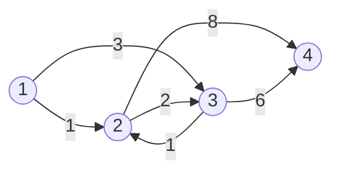

# Marco 2

## Algoritimo escolhido

Como estamos lidando com menores caminhos, o Algoritimo relacionado a essa classe de problemas é o Dijkstra. Entretando, unicamente ele não é capaz de solucionar o problema, pois ele possibilita encontrar _o_ menor caminho, mas é necessário _os_ menores caminhos.

## Instância pequena

### Entrada

```text
4 6 3
1 2 1
1 3 3
2 3 2
2 4 6
3 2 8
3 4 1
```

Os 3 números representam a quantidade de cidades ($n$), a quantidade do voôs existentes ($m$) e a quantidade de rotas de preço mínimo que é requisitado ($k$). Este valor de "$k$" determina que, de todas as rotas possíveis, deve-se apresentar o preço das $k$ mais baratas, em ordem cresente.

Logo, a primeira linha resulta nas informações: `n=4`, `m=6` e `k=3`

A seguir, as $m$ linhas seguintes informam as conexões (voôs disponíveis) e o preço respectivo. Então, temos representando visualmente:



Nessa representação temos que as cidades existêntes são os vértices e os voôs são as arestas direcionadas.

### Processamento

De forma intuitiva, nota-se que os caminhos com menores custos são, respectivamente:

- 1 -> 3 -> 4 : preço total: 4
- 1 -> 2 -> 3 -> 4 : preço total: 4
- 1 -> 2 -> 4 : preço total: 7

### Saida

Logo, temos que, em vista dos valores encontrados no processamento, a saída deve-ser:

```text
4 4 7
```

## Complexidade

Como estará sendo utilizado o algoritimo de Dijkstra como base (apesar de ser necessário modificações futuras por conta que desejamos vários caminhos mínimos), temos que a complexidade de tempo é: \
$O((V + E) \log{V})$
